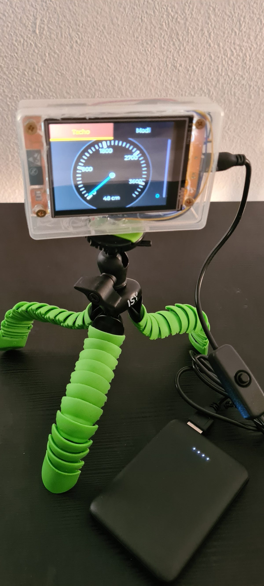
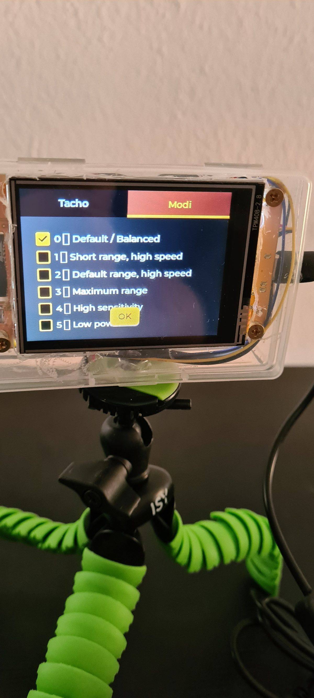
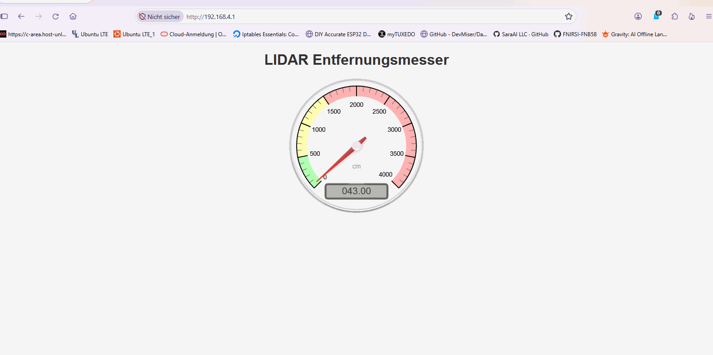
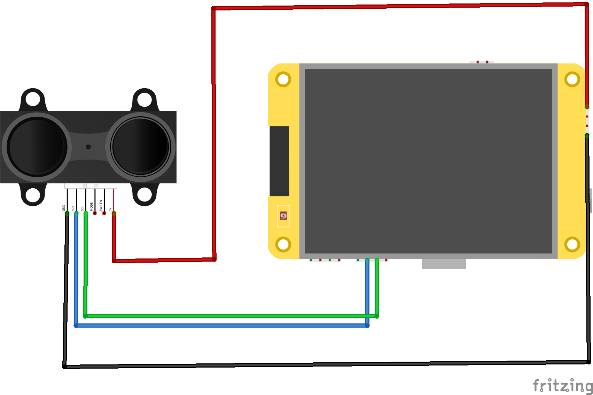

# ESP32 LiDAR Distance Monitor

A compact distance-measuring device built around the **Garmin LIDAR-Lite v3** and an **ESP32-2432S028R Cheap Yellow Display (CYD)**. The measured distance is shown on the CYD as a live, speedometer-style gauge. A built-in Wi-Fi access point also provides a browser-based dashboard for viewing the measurement remotely.

  

## Demo

The video demonstrates the distance gauge and the device in operation.

**LIDAR.mp4**

## Features

- Live distance measurement using the Garmin LIDAR-Lite v3
- Speedometer-inspired gauge on the 2.8-inch CYD display
- Touchscreen menu for selecting the sensor's measurement mode
- Wi-Fi access point with a web interface for remote monitoring
- Six selectable measurement modes, from high-speed short-range operation to maximum range

## Measurement modes

Tap the **Modes** tab on the touchscreen to open the mode selection menu.

| ID | Mode | Description |
|---:|---|---|
| 0 | Default / Balanced | Balanced combination of measurement speed, range and accuracy |
| 1 | Short Range / High Speed | Short measurement range with very high measurement speed |
| 2 | Default Range / High Speed | Standard range with increased speed at shorter distances |
| 3 | Maximum Range | Prioritizes maximum measurement range; measurements may be slower |
| 4 | High Sensitivity | Increased sensitivity, but may produce more false readings |
| 5 | Low Sensitivity | Reduced sensitivity to help avoid false readings |

The active mode ID is displayed in red in the lower-right corner of the device display.

  

## Web interface

The device starts a Wi-Fi access point that allows a phone, tablet or computer to connect to the live dashboard.

| Setting | Value |
|---|---|
| Wi-Fi network (SSID) | `LIDAR` |
| Wi-Fi password | `RADIL666` |

Connect to the access point and open the web interface in a browser. The dashboard displays the current distance using a gauge-style visualization.

  

> **Security note:** The access point credentials are configured in the firmware. Change the password in the source code before using the device in an environment where other people may be able to connect.

## Hardware

| Component | Description |
|---|---|
| Microcontroller and display | ESP32-2432S028R, commonly known as the *Cheap Yellow Display* (CYD) |
| Distance sensor | Garmin LIDAR-Lite v3 |

### Wiring

The sensor communicates with the ESP32 over I²C. The wiring illustration below shows the connections between the LIDAR-Lite v3 and the CYD.

  

For the firmware configuration shown in the project, the I²C bus uses:

| Signal | CYD / ESP32 GPIO |
|---|---:|
| SDA | GPIO 22 |
| SCL | GPIO 27 |

Connect the sensor's power and ground according to the Garmin LIDAR-Lite v3 documentation. **Check the sensor's supply-voltage requirements and ensure that the I²C bus is ESP32-compatible (3.3 V logic).** Do not connect a 5 V I²C pull-up directly to an ESP32 GPIO.

## Getting started

1. Connect the Garmin LIDAR-Lite v3 to the CYD as shown in the wiring diagram.
2. Install the required ESP32 and display libraries used by the firmware.
3. Open the Arduino sketch in the Arduino IDE.
4. Select the appropriate ESP32 board and serial port.
5. Compile and upload the firmware to the CYD.
6. Power up the device and verify that the distance is shown on the display.
7. Connect to the `LIDAR` Wi-Fi access point to view the web dashboard.

## Notes

- Measurement performance depends on the selected sensor mode and the target surface and environmental conditions.
- The Garmin LIDAR-Lite v3 is an optical distance sensor; it is not a general-purpose 3D scanning LiDAR.
- Refer to the manufacturer's documentation for detailed electrical, safety and operating specifications.

## Credits and references

- [Garmin LIDAR-Lite v3 – BerryBase](https://www.berrybase.de/garmin-lidar-lite-v3-bis-zu-40m-reichweite-1000hz-abtastrate-i2c-pwm-5v-dc)
- [ESP32-2432S028R Cheap Yellow Display – Maker Advisor](https://makeradvisor.com/tools/cyd-cheap-yellow-display-esp32-2432s028r/)
